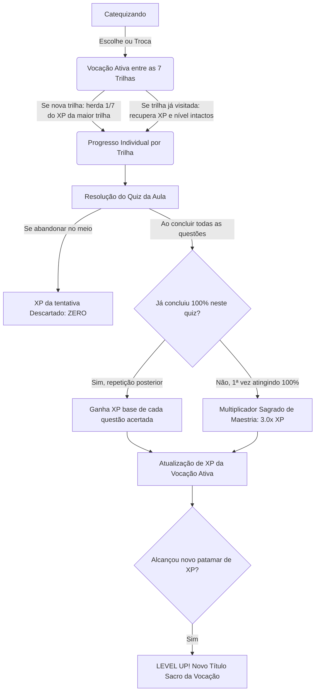
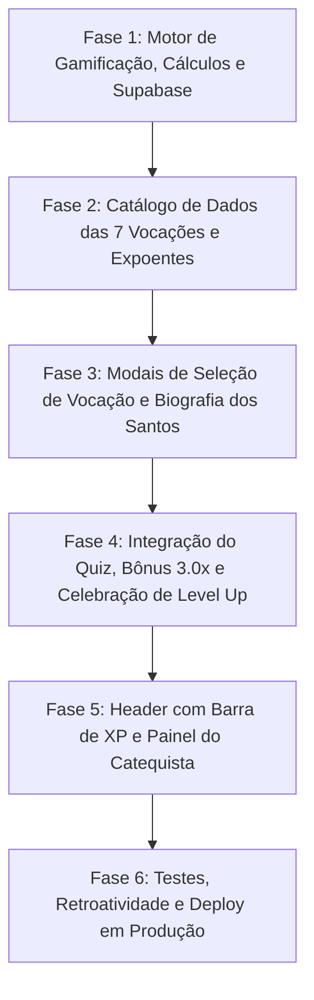

# Documento Executivo: Sistema de Gamificação Sacra & RPG Doutrinário
> **Módulo de Vocações, Progressão Espiritual e Ascensão por Experiência (XP)**  
> **Projeto:** Fides et Ratio (Fé e Razão)

---

| Metadado | Informação |
| :--- | :--- |
| **Projeto** | Fides et Ratio |
| **Módulo** | Gamificação Doutrinária & RPG Vocacional |
| **Status do Documento** | 🟢 **CONSOLIDADO E PRONTO PARA IMPLEMENTAÇÃO (V1.0.0)** |
| **Data de Criação** | 21 de Outubro de 2026 |
| **Última Atualização** | 21 de Outubro de 2026 |
| **Autores** | zrhyan & Antigravity |
| **Dependência** | Sistema Base v1.3.0 Homologado em Produção |
| **Catálogo de Vocações** | [`docs/vocacoes-e-expoentes.md`](./vocacoes-e-expoentes.md) |

---

## 1. Visão Geral e Propósito Teológico-Pedagógico

O projeto **Fides et Ratio** tem como missão precípua a formação intelectual e doutrinária dos catequizandos, harmonizando as asas da fé e da razão humana. Na tradição da Igreja Católica, o crescimento na fé nunca foi encarado como um estado estático, mas como uma **peregrinação (*peregrinatio*)**, uma ascese de constante amadurecimento — desde os *preâmbulos da fé* (*praeambula fidei*) até a profunda contemplação mística e a sabedoria teológica (como em *Itinerarium Mentis in Deum* de São Boaventura ou na *Subida do Monte Carmelo* de São João da Cruz).

A introdução de elementos de **RPG e Gamificação Sacra** tem por objetivo:
1. **Engajamento e Continuidade:** Motivar o estudante a perseverar nos estudos, revisitar conceitos e desafiar a si mesmo na resolução dos módulos.
2. **Personalização da Jornada Cristã:** Permitir que cada catequizando escolha uma **Vocação (Trilha)** que reflita sua inclinação espiritual e carismática predominante entre as 7 grandes vias históricas da Igreja.
3. **Reconhecimento do Esforço:** Recompensar o acerto de questões com **Pontos de Experiência (XP)**, celebrando a evolução de graus de maturidade na fé.
4. **Resgate Histórico e Hagiográfico:** Permitir aos catequizandos explorar todos os grandes expoentes, santos, cientistas, poetas e teólogos que moldaram a civilização cristã.

---

## 2. Pilares Fundamentais da Mecânica de RPG



---

## 3. As 7 Vocações Oficiais da Igreja Católica

Conforme estruturado em [`docs/vocacoes-e-expoentes.md`](./vocacoes-e-expoentes.md), o sistema contempla **7 Vocações**, cada uma com seus títulos de ascensão do Nível 1 ao Nível 7 (Ápice):

### 3.1 Vocação Intelectual (Teológica, Filosófica e Científica)
- **Axioma:** *Fides quaerens intellectum* (Santo Anselmo).
- **Carisma:** O rigor lógico, a metafísica, a teologia sistemática, o diálogo com a ciência e a busca da Verdade pelo intelecto iluminado pela graça.
- **Expoentes:** Santo Tomás de Aquino, Santo Agostinho, Beato Duns Escoto, Santo Anselmo, Beato Ramon Llull, Santo Alberto Magno, São Basílio Magno, Santa Hildegarda de Bingen, São Boaventura, São João Damasceno, Francisco Suárez, Blaise Pascal, São John Henry Newman, Santa Teresa Benedita da Cruz (Edith Stein).
- **Títulos de Progressão (Níveis 1 a 7):**
  1. *Ouvinte dos Preâmbulos*
  2. *Discípulo Escolástico*
  3. *Bacharel das Súmulas*
  4. *Leitor Sentenciário*
  5. *Magister Teológico*
  6. *Mestre Disputante*
  7. *Doutor da Igreja* (Ápice)

### 3.2 Vocação Mística e Contemplativa
- **Axioma:** A união transformante da alma com Deus no fogo da caridade infusa.
- **Carisma:** O silêncio orante, o recolhimento interior, os sete graus do Castelo Interior e o excesso mental na contemplação da Trindade.
- **Expoentes:** Santa Teresa de Ávila, São João da Cruz, Santa Teresinha do Menino Jesus, São Boaventura, Santo Agostinho, São Gregório Magno, São Gregório de Narek, Santa Hildegarda de Bingen, Santo Tomás de Aquino, Beato Ramon Llull, Beato João Ruusbroec, Santa Catarina de Sena, São Nicolau de Flüe, São Francisco de Sales, São Carlos de Foucauld, Edith Stein.
- **Títulos de Progressão (Níveis 1 a 7):**
  1. *Peregrino do Átrio*
  2. *Buscador do Recolhimento*
  3. *Habitante das Quintas Moradas*
  4. *Contemplador da Noite Escura*
  5. *Chama Viva de Amor*
  6. *Matrimônio Espiritual*
  7. *Doutor Místico* (Ápice)

### 3.3 Vocação Apologética
- **Axioma:** *"Estai sempre prontos a dar a razão da vossa esperança"* (1 Pd 3,15).
- **Carisma:** A defesa pública e racional da fé, a refutação de heresias, o diálogo inter-religioso e a demolição de sofismas anticristãos.
- **Expoentes:** São Justino Mártir, Santo Irineu de Lyon, Santo Agostinho, São João Damasceno, Santo Tomás de Aquino, Beato Ramon Llull, São Roberto Belarmino, São Francisco de Sales, Blaise Pascal, São John Henry Newman, G. K. Chesterton, Venerável Fulton J. Sheen.
- **Títulos de Progressão (Níveis 1 a 7):**
  1. *Catecúmeno em Defesa*
  2. *Sentinela da Ortodoxia*
  3. *Polemosta da Verdade*
  4. *Escudo da Tradição*
  5. *Defensor Fidei*
  6. *Mártir da Razão*
  7. *Apologeta Iluminado* (Ápice)

### 3.4 Vocação Caritativa e Social (Misericórdia Operante)
- **Axioma:** *"Tudo o que fizestes a um destes meus irmãos mais pequeninos, a mim o fizestes"* (Mt 25,40).
- **Carisma:** As obras de misericórdia corporais e espirituais, o cuidado com doentes, famintos, escravizados e a fundação de hospitais e redes de socorro.
- **Expoentes:** São Basílio Magno, São Gregório Magno, Santa Isabel da Hungria, São João de Deus, São Carlos Borromeu, São Camilo de Léllis, São Vicente de Paulo, Santa Luísa de Marillac, São Pedro Claver, Beato Frederico Ozanam, Santa Dulce dos Pobres, Santa Teresa de Calcutá.
- **Títulos de Progressão (Níveis 1 a 7):**
  1. *Servidor dos Pobres*
  2. *Irmão Hospitaleiro*
  3. *Bálsamo dos Aflitos*
  4. *Arauto da Misericórdia*
  5. *Coluna da Basiliade*
  6. *Servo dos Servos de Deus*
  7. *Pai dos Desamparados* (Ápice)

### 3.5 Vocação Querigmática e Missionária
- **Axioma:** *"Ide por todo o mundo, pregai o Evangelho a toda criatura"* (Mc 16,15).
- **Carisma:** O primeiro anúncio (*kerygma*), a partida para terras distantes (*ad gentes*), a inculturação da fé e o ardor pelo batismo dos povos.
- **Expoentes:** São Paulo Apóstolo, São Gregório Magno, São Bonifácio, Santos Cirilo e Metódio, Beato Ramon Llull, São Francisco Xavier, Venerável Matteo Ricci, São José de Anchieta, São Roque González, São Pedro Claver, São Daniele Comboni, Beata Pauline Jaricot, Santa Teresinha do Menino Jesus, Venerável Fulton Sheen.
- **Títulos de Progressão (Níveis 1 a 7):**
  1. *Peregrino do Evangelho*
  2. *Semeador do Kerygma*
  3. *Voz no Areópago*
  4. *Desbravador dos Gentios*
  5. *Arauto das Nações*
  6. *Apóstolo dos Povos*
  7. *Patrono das Missões* (Ápice)

### 3.6 Vocação Pastoral, Educativa e Formadora
- **Axioma:** O cura d’almas (*cura animarum*), a pedagogia do coração e a formação integral da pessoa humana.
- **Carisma:** O pastoreio das ovelhas, o confessionário, o método preventivo na educação e a catequese adaptada aos simples.
- **Expoentes:** São Basílio Magno, Santo Agostinho, São Gregório Magno, Santa Hildegarda de Bingen, São Carlos Borromeu, São Filipe Néri, São Roberto Belarmino, São Francisco de Sales, São Vicente de Paulo, São José de Calasanz, São João Batista de La Salle, São João Maria Vianney (Cura d’Ars), São João Bosco, Edith Stein, São Josemaria Escrivá.
- **Títulos de Progressão (Níveis 1 a 7):**
  1. *Catequista dos Simples*
  2. *Educador de Almas*
  3. *Pastor da Juventude*
  4. *Médico dos Penitentes*
  5. *Mestre do Sistema Preventivo*
  6. *Bom Pastor das Comunidades*
  7. *Patrono dos Pastores* (Ápice)

### 3.7 Vocação Artística, Poética e Litúrgica (Via Pulchritudinis)
- **Axioma:** O caminho da beleza que desarma o coração e revela o esplendor do Verbo Encarnado (*De Musica*, de Santo Agostinho).
- **Carisma:** A música sacra, o canto gregoriano, a arquitetura gótica, o ícone sagrado, a poesia mística e os mistérios litúrgicos.
- **Expoentes:** Santo Efrém da Síria, São Romano o Melodo, Santo Agostinho, São Gregório Magno, São João Damasceno, São Gregório de Narek, Abade Suger de Saint-Denis, Santa Hildegarda de Bingen, Santo Tomás de Aquino, Dante Alighieri, Fra Angelico, Andrei Rublev, São João da Cruz, Giovanni da Palestrina, São John Henry Newman, Dom Próspero Guéranger, G. K. Chesterton, Servo de Deus Antoni Gaudí.
- **Títulos de Progressão (Níveis 1 a 7):**
  1. *Cantor do Santuário*
  2. *Artesão da Pedra e da Luz*
  3. *Iconógrafo do Mistério*
  4. *Harpa do Espírito Santo*
  5. *Mestre de Capela Celeste*
  6. *Poeta da Divina Comédia*
  7. *Artífice do Templo de Deus* (Ápice)

---

## 4. Economia de XP e Curva de Níveis

### 4.1 Base de Cálculo por Questão
- Cada questão tem o valor padrão de **100 XP** (configurável pelo catequista no painel de administração).
- Um módulo padrão de 30 questões concede **3.000 XP base** ao ser concluído com acerto total.

### 4.2 Multiplicador Sagrado de Maestria (3.0x) e Repetição
- **Primeira Conclusão com 100% de Acerto:** Concede um bônus de **3.0x** sobre o XP total das questões (ex.: 30 questões de 100 XP = 3.000 XP × 3 = **9.000 XP**).
- **Repetições Subsequentes:** Ao refazer um quiz que o aluno já gabaritou anteriormente, ele não recebe mais o multiplicador de 3.0x, mas recebe o XP base de cada questão acertada naquela rodada (ex.: 30 acertos = 3.000 XP).
- **Abandono no meio do Quiz:** XP descartado (0 XP).

### 4.3 Curva de Níveis Calibrada para os 4 Módulos Oficiais
O projeto final do *Fides et Ratio* contará com 4 grandes módulos formativos (~30 questões cada). A conclusão com 100% dos 4 módulos confere $4 \times 9.000\text{ XP} = 36.000\text{ XP}$, o que conduz o estudante exatamente ao **Nível 4**. Os níveis 5, 6 e 7 exigirão estudo perseverante e repetições práticas:

| Nível | Título Genérico de Ascensão | XP Acumulado Necessário | Esforço Equivalente |
| :-: | :--- | :-: | :--- |
| **Nível 1** | *Iniciante / Ouvinte* | **0 XP** | Ponto de partida de todo catequizando |
| **Nível 2** | *Discípulo / Sentinela* | **9.000 XP** | Concluir 1 módulo oficial com 100% |
| **Nível 3** | *Bacharel / Defensor* | **22.000 XP** | Concluir ~2 módulos com 100% + revisões |
| **Nível 4** | *Leitor / Escudo* | **36.000 XP** | **Conclusão com 100% dos 4 Módulos Oficiais!** |
| **Nível 5** | *Magister / Arauto* | **60.000 XP** | Exige prática, repetição e consolidação |
| **Nível 6** | *Mestre / Apóstolo* | **90.000 XP** | Dedicação e domínio contínuo |
| **Nível 7** | *Doutor / Ápice* | **130.000 XP** | Grau supremo de consagração na vocação |

### 4.4 Troca de Vocação e Herança de 1/7 do XP
1. O usuário permanece sempre em exatamente uma vocação ativa.
2. Cada vocação guarda individualmente seu próprio saldo de XP e nível.
3. **Regra de Herança Sagrada (1/7):** Ao consagrar-se pela primeira vez em uma vocação nova (na qual possui 0 XP), ele recebe de herança **1/7 (~14,28%) do XP de sua vocação de maior pontuação**.
   - *Exemplo:* Um aluno no Nível 4 com 36.000 XP na Vocação Intelectual migra pela primeira vez para a Vocação Mística. Ele começa com $\lfloor 36.000 \div 7 \rfloor = 5.142\text{ XP}$ (entrando já no Nível 1 avançado, quase Nível 2).
4. **Retorno a Vocação Anterior:** Ao regressar para uma vocação onde já esteve antes, o usuário encontra o XP e nível exatamente como estavam ao deixá-la.

### 4.5 Retroatividade para Alunos Existentes
- Ao carregar o perfil de um catequizando que já realizou quizzes (registrados em `attempts`), o sistema calcula retroativamente o total de XP merecido:
  - Para cada quiz com 100% alcançado: $30 \times 100 \times 3.0 = 9.000\text{ XP}$.
  - Para quizzes sem 100%: total de acertos da melhor tentativa $\times 100\text{ XP}$.
- Esse saldo inicial é creditado automaticamente na vocação padrão (*Intelectual*), garantindo que nenhum aluno perca seu progresso já conquistado.

---

## 5. Modelagem do Banco de Dados (Supabase + LocalStorage)

### 5.1 Tabela `user_profiles` no Supabase
```sql
CREATE TABLE IF NOT EXISTS user_profiles (
  username TEXT PRIMARY KEY,
  active_vocation TEXT NOT NULL DEFAULT 'intelectual',
  vocations_data JSONB NOT NULL DEFAULT '{}'::jsonb,
  completed_quizzes_100 TEXT[] DEFAULT ARRAY[]::TEXT[],
  created_at TIMESTAMPTZ DEFAULT NOW(),
  updated_at TIMESTAMPTZ DEFAULT NOW()
);

-- Habilitar RLS público para leitura e escrita transparente
ALTER TABLE user_profiles ENABLE ROW LEVEL SECURITY;
CREATE POLICY "Permitir acesso total a user_profiles"
  ON user_profiles FOR ALL USING (true);
```

### 5.2 Estrutura do `vocations_data` (JSONB)
```json
{
  "intelectual": { "xp": 36000, "level": 4, "visited": true },
  "mistica": { "xp": 5142, "level": 1, "visited": true },
  "apologetica": { "xp": 0, "level": 1, "visited": false },
  "caritativa": { "xp": 0, "level": 1, "visited": false },
  "missionaria": { "xp": 0, "level": 1, "visited": false },
  "pastoral": { "xp": 0, "level": 1, "visited": false },
  "artistica": { "xp": 0, "level": 1, "visited": false }
}
```

---

## 6. Arquitetura da Interface e Componentes

1. **Header do Site (`Header.jsx`):**
   - Crachá sacro com o ícone litúrgico da vocação ativa, título atual (ex.: *"Leitor Sentenciário"*), Nível e barra de XP fluida com indicador numérico (ex.: *"36.000 / 60.000 XP"*).
   - Clique no crachá abre o **Modal de Vocações**.
2. **Catálogo de Vocações e Expoentes (`VocationModal.jsx` & `SaintDetailModal.jsx`):**
   - Navegação pelas 7 Vocações, com selo litúrgico, lema latino e carisma.
   - Grade completa de retratos clássicos e fotos históricas de todos os expoentes catalogados.
   - Ao tocar na imagem de um expoente: modal solene com retrato em destaque e biografia completa do santo na ótica daquela vocação.
   - Botão de Consagração/Troca de Vocação com exibição prévia do XP inicial herdado (1/7).
3. **Feedback no Desfecho do Quiz (`QuizResult.jsx`):**
   - Banner comemorativo de XP: *"Experiência Adquirida: +X XP"*.
   - Se gabaritou 100% pela primeira vez: selo dourado *"Multiplicador Sagrado 3.0x Ativado!"* e confetes.
   - Se subiu de nível: card de celebração *"LEVEL UP! Você alcançou o Grau de [Novo Título]!"*.
4. **Painel do Catequista (`AdminPanel.jsx`):**
   - Formulário de quizzes com campo `xpReward` por questão.
   - Aba de alunos com colunas: Vocação Ativa, Nível e XP Acumulado.

---

## 7. Roteiro de Execução em Fases



- **Fase 1:** Serviços de storage, cálculo de XP/níveis, herança de 1/7, retroatividade de alunos e persistência (Supabase/localStorage).
- **Fase 2:** Arquivo estruturado de dados (`src/data/vocationsData.js`) com as 7 vocações e todos os expoentes com biografias e referências de imagens.
- **Fase 3:** Interface visual do catálogo de vocações e modal de biografia individual dos santos com design sacro.
- **Fase 4:** Atualização do `QuizPlayer` e `QuizResult` com regra estrita de abandono, crédito de XP, multiplicador 3.0x e animação de subida de nível.
- **Fase 5:** Atualização do `Header` com indicador de vocação/barra de XP e enriquecimento da aba de alunos no `AdminPanel`.
- **Fase 6:** Validação completa em tela mobile (320px+), build sem erros, atualização de `CHANGELOGS.md` e push para o repositório.
